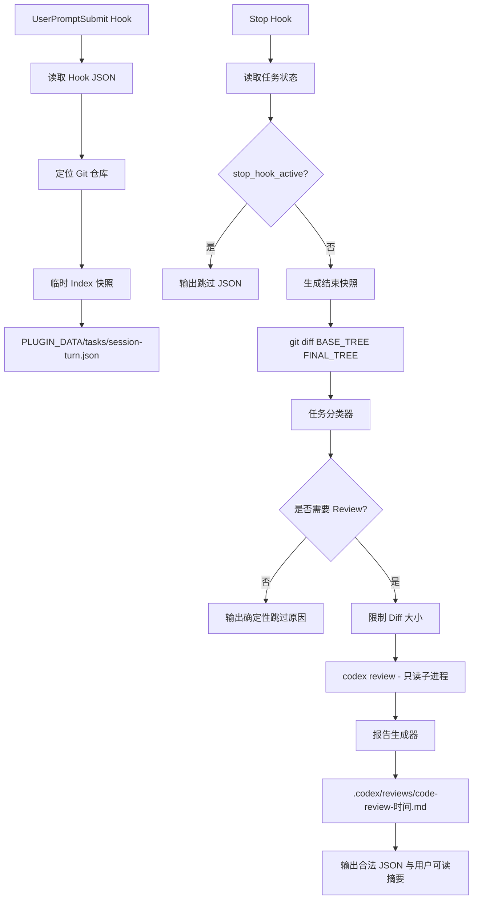

# Codex Task Review 设计

## 意图与目标

`codex-task-review` 是一个面向 OpenAI Codex CLI 的任务级代码审查插件。它在每轮任务开始与结束时分别记录 Git 工作区快照，只把本轮任务新增的代码变化交给独立的只读 Reviewer，并把结果写成 Markdown 报告供用户查看。

项目目标：

- 以 Windows 10/11、PowerShell、Git for Windows、Python 3 和 Codex CLI 为主要运行环境。
- 通过 Codex 官方 Plugin + Marketplace 机制安装，不要求用户手工修改全局 hooks。
- 严格隔离 `session_id + turn_id` 任务状态，避免跨会话、跨任务和并行任务串数据。
- 对简单 Bug 修复与纯 UI 修改采用确定性跳过规则；不确定或高风险任务默认审查。
- 审查为 report-only，不自动修改、暂存、提交或清理用户代码。
- 提供可配置阈值、风险关键字、风险路径、报告目录、超时和 Diff 大小上限。
- 提供可重复执行的单元测试和临时 Git 仓库集成测试。

## 非目标与禁止事项

- 不实现云端服务、MCP 服务、额外 API Key 或外部数据库。
- 不自动修复审查问题，不自动触发主 Agent 继续工作，不自动提交或暂存 Git。
- 不修改用户现有的 `PostToolUse` 与 `Stop` 全局 Hook。
- 不将报告文件加入任务 Diff，也不把任务开始前遗留脏文件当成本轮修改。
- 不依赖 Linux/WSL/Bash 专属脚本或硬编码用户目录。

## 当前环境与规范依据

- 本机 Codex CLI 版本为 `0.172.0`。
- `codex review --help` 已确认支持 `codex review -`，可从 stdin 读取自定义审查指令；本项目优先使用该命令。
- 当前 OpenAI 插件文档推荐根目录 portable `plugin.json`，并支持 `extensions.com.openai.hooks`；但当前 Codex 源码的插件加载器会对 `AgentPlugin` 格式返回空 Hook 列表。相关依据：[插件打包文档](https://developers.openai.com/plugins/build/plugins)、[Codex 插件加载器](https://github.com/openai/codex/blob/main/codex-rs/core-plugins/src/loader.rs#L3853-L3873)。
- 为让 Codex 优先读取 `.codex-plugin/plugin.json` 并加载插件 Hooks，本项目采用独立 Codex 兼容清单，不包含根目录 portable `plugin.json`。Codex 兼容格式支持 `hooks` 字段、`PLUGIN_ROOT` 与 `PLUGIN_DATA`；详见 [插件 Hook 指南](https://developers.openai.com/codex/hooks)。该格式不提供 Agent Plugins 主机的 portable manifest 入口。
- 插件 Hook 在用户检查并信任当前 Hook 定义之前不会运行；含生命周期 Hook 的包不符合 OpenAI 公共插件目录的提交资格。GitHub Marketplace 安装和手动 Codex 分发仍作为本项目发布路线。
- Hook 输出遵循 Codex 的通用 JSON 字段：`continue`、`stopReason`、`suppressOutput`、`systemMessage`；本项目不返回 `decision:block`，任何失败都允许主 Agent 正常结束。
- 根目录 Marketplace 文件为 `.agents/plugins/marketplace.json`；插件位于当前 GitHub 仓库根目录，因此使用 `source: "url"`，仓库地址保留 `YOUR_GITHUB_USERNAME` 占位符。

## 方案对比与选型

### 方案 A：portable manifest + legacy 兼容回退（已放弃）

- 根目录 `plugin.json` 是当前官方推荐的 portable 入口。
- `.codex-plugin/plugin.json` 提供旧版 Codex 兼容入口；两份 manifest 共用根目录 Hook 和脚本。
- `hooks/hooks.json` 注册 `UserPromptSubmit` 和 `Stop`，同时提供 `command` 与 `commandWindows`；Windows 优先执行 `py -3 "${PLUGIN_ROOT}/hooks/task_review.py"`，找不到 `py` 时由入口输出可读错误并安全放行。
- `.agents/plugins/marketplace.json` 使用 GitHub 根仓库 URL，安装命令保持官方 `codex plugin marketplace add` / `codex plugin add` 流程。

初选原因：同时保留 portable 包身份和 Codex 兼容入口，不增加运行时依赖。

### 方案 B：仅 Codex 兼容结构（当前选择）

只维护 `.codex-plugin/plugin.json` 与兼容 Hook。该方案牺牲 portable Agent Plugins 入口，但当前 Codex 文档说明 Codex 格式支持插件 Hooks，且当前 Codex 源码未从 Agent Plugins 格式加载插件 Hooks。用户于 2026-11-26 选择优先确保 Codex Hook 可运行；若上游加载器行为改变，再评估恢复 portable manifest。

### 方案 C：仓库内 `plugins/codex-task-review` 子目录

适合多插件 monorepo，但会增加用户安装时的 source 路径和 sparse checkout 约束；本项目要求单独上传当前仓库即可使用，因此放弃。

## 架构

### 入口与模块

- `hooks/task_review.py`：Hook 进程入口；读取 stdin、调用业务层、捕获所有异常并保证返回合法 JSON。
- `codex_task_review/models.py`：任务、快照、Diff、分类和审查结果的数据模型。
- `codex_task_review/config.py`：默认配置、JSON 配置文件解析、环境变量和路径解析。
- `codex_task_review/state.py`：以 `session_id + turn_id` 为键的原子状态文件读写、清理和并发隔离。
- `codex_task_review/git_snapshot.py`：临时 Index 生命周期、Tree ID 获取、同仓库校验和二进制 Diff。
- `codex_task_review/classifier.py`：仅基于 Prompt、Diff、路径和统计信息的确定性分类器。
- `codex_task_review/reviewer.py`：`codex review -` 的参数、stdin、超时、递归防护和失败降级。
- `codex_task_review/report.py`：报告路径、Markdown 结构、分级问题和未检查项输出。

## 精确 Diff 设计

任务开始与结束均执行同一套临时 Index 流程：

1. 创建仅供当前进程使用的临时 `GIT_INDEX_FILE`，路径位于临时目录并使用 `pathlib`。
2. 用 `git read-tree HEAD` 初始化临时 Index；没有 `HEAD` 时返回明确的无初始提交错误。
3. 用 `git add -A` 将当前工作区（含暂存、未暂存、未跟踪、删除）写入临时 Index。
4. 用 `git write-tree` 得到工作区 Tree ID。
5. 结束阶段再次执行相同流程，并要求仓库根路径与开始状态一致。
6. 用 `git diff --binary -M BASE_TREE FINAL_TREE` 生成本轮 Diff。FINAL Tree 与 Diff 必须在任何报告目录写入之前完成；报告目录已经存在时也不重新计算快照，报告写入失败不能重算 Diff，也不能让报告文件进入本轮 Diff。

临时 Index 不触碰用户真正的 Index；禁止执行 `reset`、`checkout`、`clean`、自动 `add` 或提交。Windows 路径通过 subprocess 参数数组传递，支持中文路径和空格。二进制 Diff 使用 UTF-8 解码时采用可逆错误处理，Reviewer 收到完整字节语义而不因乱码崩溃。

## 状态与并发

- 状态根目录：`${PLUGIN_DATA}/tasks/`。
- 键格式：对 `session_id`、`turn_id` 做安全编码后组合，禁止直接使用用户可控路径片段。
- 写入采用同目录临时文件 + `os.replace`，读取失败时不回退到整个分支 Diff。
- 同一任务 Stop 重入时，`stop_hook_active` 或已完成标志均只输出一次安全跳过结果。
- 状态包含仓库根、开始 Tree ID、开始时间、Prompt 摘要、配置版本；结束后只清理当前任务文件。

## Hook 输入输出契约

入口只接受 stdin 的一个 JSON 对象，不读取命令行拼接参数。`UserPromptSubmit` 至少读取并校验 `session_id`、`turn_id`、`cwd`、`prompt`、`hook_event_name`；`Stop` 至少读取并校验 `session_id`、`turn_id`、`cwd`、`stop_hook_active`、`last_assistant_message`、`hook_event_name`。`transcript_path`、`model`、`permission_mode` 等额外字段原样忽略。

入口始终输出可解析的 JSON，成功、跳过、缺少状态、仓库不是 Git、无初始 `HEAD`、仓库根变化、Diff 超限、Reviewer 失败和递归保护都使用 `continue: true`，并在 `systemMessage` 中给出原因；不输出 `decision: "block"`。为便于测试与诊断，内部状态摘要使用固定的 `status` 与 `reason_code` 生成消息，但不添加 Codex 未声明的顶层字段。

`UserPromptSubmit` 成功时保存状态并输出“任务快照已记录”；输入校验失败时不创建状态。`Stop` 成功时先完成快照与 Diff，再执行分类/审查/报告；找不到对应状态时严禁退化为 `git diff HEAD` 或分支 Diff，直接输出缺少状态原因。

## 任务分类

分类优先级如下：

1. `[review:force]` 直接强制 Review。
2. 无 Diff 直接跳过。
3. 高风险关键字/路径（安全、权限、认证、支付、订单、财务、数据库、迁移、并发、缓存、CI/CD、依赖等）直接 Review。
4. 涉及 API、状态管理、业务逻辑、校验、持久化或权限的 JSX/TSX/Vue 等文件直接 Review。
5. 纯 UI 文件与展示结构只有在 Diff 实际未包含业务逻辑时才可跳过。
6. 简单 Bug 修复仅在 Prompt 明确、文件数不超过 `max_bugfix_files`、变更行数不超过 `max_bugfix_changed_lines` 且无高风险内容时跳过。
7. 其他情况默认 Review。

分类器输出机器可读的 `kind`、`should_review`、`reason`、文件数、增删行数和命中的风险证据，报告与 Hook 摘要复用同一结果。

## Reviewer 设计

- 首次执行时调用 `codex review --help` 的结果已验证 stdin 用法；运行时执行 `codex review -`。
- Prompt 包含任务描述、严格审查范围、完整 Diff、等级定义、精确行号要求和禁止修改声明。
- 不在用户仓库中直接运行 Reviewer。先用 `git archive FINAL_TREE` 将最终 Tree 导出到临时目录，在该目录初始化临时 Git 仓库并提交最终快照，然后从原仓库传入 BASE→FINAL 的完整 Diff；这样 Reviewer 即使读取 cwd，也看不到任务开始前遗留的脏文件。
- Reviewer 工作目录在系统临时目录，执行前设置 `CODEX_TASK_REVIEW_ACTIVE=1`，入口检测该变量后直接返回递归跳过 JSON；子进程通过 Codex CLI 的 `--sandbox read-only` 参数请求只读沙箱，且测试验证 Reviewer 失败路径不会修改原仓库。
- Reviewer 失败、超时、命令不存在或 Diff 超过 `max_diff_bytes` 时，Stop Hook 不阻塞主 Agent：写入“未完成审查”的报告并输出失败原因。
- Reviewer 只能读取上下文，代码修改由插件进程无法触发；测试会验证 Reviewer 失败路径不改动项目文件。

## 报告格式

默认写入当前仓库 `.codex/reviews/code-review-YYYY-MM-DD-HH-mm-ss.md`，报告包含：

1. 审查基本信息和任务描述。
2. Git Diff 的 BASE_TREE、FINAL_TREE、仓库根和修改时间。
3. 修改文件清单及增删统计。
4. 总体结论。
5. P0/P1/P2/P3 问题，每项含标题、严重程度、文件、行号、触发条件、影响、证据、建议、推荐测试和置信度。
6. 已检查且未发现问题的方面。
7. 未能检查的方面及原因。
8. 修复建议汇总。

报告写入使用 UTF-8、创建目录时不加入 Git 快照；报告生成失败只返回 Hook 错误摘要，不尝试修复或回滚源代码。

## 配置

默认配置文件为项目根 `.codex/task-review.json`，只在用户主动创建时读取；插件安装目录不保存用户配置。默认值包括：

- `skip_simple_bugfix: true`
- `skip_pure_ui: true`
- `max_bugfix_files: 3`
- `max_bugfix_changed_lines: 80`
- `force_review_marker: "[review:force]"`
- `report_directory: ".codex/reviews"`
- `review_timeout: 600`
- `max_diff_bytes: 1048576`
- 可配置 `high_risk_keywords`、`high_risk_paths`

配置解析错误使用默认值并在 Hook 输出中提示；不把配置文件内容写入 Reviewer Prompt 之外的敏感日志。

## 测试策略

使用 Python `unittest` 和临时目录/临时 Git 仓库，覆盖任务原文列出的 21 类场景：快照包含新增、修改、删除、暂存和未暂存；开始前脏文件隔离；session/turn 并行隔离；无变化与分类跳过；高风险和强制 Review；Reviewer 失败、递归保护、只读行为；合法 JSON；中文与空格路径；Review 临时工作区不包含无关脏文件。

测试不会使用用户真实仓库，也不会改写用户全局 `C:\Users\Xie\.codex\hooks.json`。每个实现切片先跑聚焦测试，再跑完整 `python -m unittest discover -s tests -v`。

## 风险与取舍

- Hook 依赖用户本机已安装 `git`、`python` 和 `codex`；缺失时只跳过/报告，不阻塞任务。
- Windows Hook 同时保留 POSIX `command` 和 `commandWindows`；`commandWindows` 通过 `py -3` 启动，解释器不可用时返回安全放行 JSON，README 提供 `py -3`、`python` 和 PATH 排查步骤。
- `codex review` 的输出格式可能随 CLI 版本变化，因此报告保留原始 Reviewer 文本并标注解析不确定性，不强行猜测问题等级。
- 插件包含生命周期 Hook，适合 GitHub Marketplace/手动 Codex 安装，不保证进入 OpenAI 公共插件目录；README 会明确这一点。
- 对没有初始 `HEAD` 的新仓库不生成伪 Diff，优先安全跳过并报告原因。

## 交付清单

- `.codex-plugin/plugin.json`、`hooks/hooks.json` 与根目录 Marketplace/示例/README。
- `hooks/hooks.json`、`hooks/task_review.py` 与 Python 业务模块。
- `.agents/plugins/marketplace.json`，GitHub 用户名使用占位符。
- 中文 README、配置示例、审查报告示例、MIT LICENSE、`.gitignore`。
- 单元测试和临时 Git 集成测试。
- 分阶段本地 Git 提交，提交格式为 `feat：`、`fix：`、`test：`、`docs：` 等中文描述，不推送远程。
